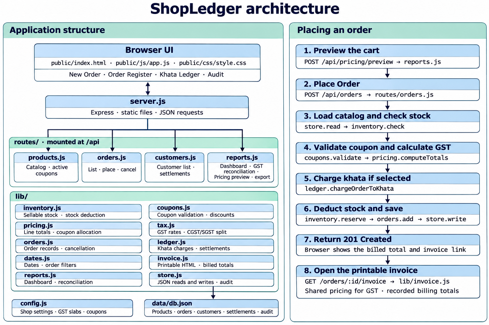

# ShopLedger architecture

Orders affect several records at once. A checkout creates an order, deducts stock, and may charge a customer's khata, or store-credit account. The Express routes coordinate those actions and pass the shared data to modules in `lib/`.

[Compact architecture diagram](shopledger-architecture.png)

## Module map

| Path | Responsibility |
| --- | --- |
| [`server.js`](../server.js) | Parses JSON, serves the browser files, mounts the four routers under `/api`, and serves the printable invoice route. |
| [`public/`](../public/) | HTML and CSS plus browser JavaScript for checkout, order history, Khata, and Audit. The browser uses XMLHttpRequest for API calls. |
| [`routes/products.js`](../routes/products.js) | Lists catalog products, physical and sellable stock, and active coupons. |
| [`routes/orders.js`](../routes/orders.js) | Lists and retrieves orders, commits new sales, and handles cancellation. |
| [`routes/customers.js`](../routes/customers.js) | Lists customers and recent settlements, then records payments against customer balances. |
| [`routes/reports.js`](../routes/reports.js) | Serves the dashboard, GST reconciliation, pricing preview, and keyed export. |
| [`lib/orders.js`](../lib/orders.js) · [`lib/dates.js`](../lib/dates.js) | Create, find, list, and cancel order records. Date helpers format display dates, build chronological keys, and calculate fiscal-year labels. |
| [`lib/inventory.js`](../lib/inventory.js) | Computes sellable stock, validates quantities by SKU, adjusts physical stock, releases quote reservations, and summarizes inventory. |
| [`lib/pricing.js`](../lib/pricing.js) · [`lib/tax.js`](../lib/tax.js) · [`lib/coupons.js`](../lib/coupons.js) | Apply coupon rules, allocate discounts across items, calculate goods and services tax (GST), and split it into central and state GST. |
| [`lib/ledger.js`](../lib/ledger.js) | Calculates khata balances, checks credit limits, charges and reverses sales, and records settlements. |
| [`lib/invoice.js`](../lib/invoice.js) · [`lib/reports.js`](../lib/reports.js) | Render printable invoices and calculate dashboard and reconciliation figures. |
| [`lib/store.js`](../lib/store.js) · [`data/db.json`](../data/db.json) | Read and overwrite the datastore and retain the latest 100 audit entries. |
| [`config.js`](../config.js) | Supplies the listening port, shop metadata, admin export key, tax settings, inventory defaults, and coupon definitions. |

## From cart to saved order

1. The browser sends product IDs, quantities, and an optional coupon to the pricing preview. The server resolves catalog prices and returns projected totals and coupon status.
2. When the operator submits the order, the orders router reads a fresh copy of the datastore. It rebuilds each line using catalog values, checks aggregate quantities against sellable stock, and validates the coupon.
3. Pricing allocates the cart discount in proportion to line gross amounts, rounds line amounts to two decimals, and applies GST to each discounted line. The tax module splits total GST into CGST and SGST, with SGST taking the remainder after rounding CGST.
4. For a khata sale, the ledger checks the projected balance against the customer's configured credit limit and adds the order to total billed. The route then deducts physical stock, saves the order and audit entry, writes the datastore, and sends the order back to the browser.
5. The invoice route runs separately when the operator opens the invoice. It finds the saved order, rebuilds the GST breakdown with shared pricing, and prints recorded billing totals when available.

## Stock, credit, and dates

Physical stock counts units on hand. Reserved stock holds units for wholesale quotes. Selling or cancelling an order changes physical stock and leaves wholesale reservations intact. A pending order has already committed its stock and any khata charge. Cancelling it restores stock and reverses that charge when applicable. A repeat cancellation is rejected.

A customer's balance is opening balance plus total billed minus total settled. Cash and UPI are recorded payment labels. The app has no payment-processing integration. The settlement handler converts the submitted amount to a number, rounds it to two decimals, and applies that same amount to the balance and the settlement history.

Order dates retain the day-first display format. Order history compares year-first date keys for sorting and inclusive date filters, and uses the order ID to break ties on the same day.

## Invoices and reconciliation

The order record stores item prices, quantities, HSN codes, and aggregate billing totals. It does not store a full snapshot of each line's tax or coupon allocation. The invoice uses recorded subtotal, discount, GST, and total where available. When current pricing fails to reproduce the saved subtotal, discount, or tax, the invoice omits the line-level GST and explains the discrepancy.

The Audit table compares saved billing figures against a recalculation. Its **Invoice GST** and **Invoice Total** columns represent that recalculation. For older orders, those columns may differ from the linked printable invoice. The printed invoice preserves the amount billed.

## Configuration and storage

| Setting or field | Behavior |
| --- | --- |
| `PORT` | Environment override. The default listener port is `3000`. |
| `shop` | Store name, contact details, GST registration number, and state information for dashboard and invoice presentation. |
| `tax.defaultRate`, `tax.hsnSlabs` | A decimal fallback rate of `0.18` and an exact HSN-code lookup whose configured values are percentages. Internal pricing prefers a numeric `gstRate` already on its input item. Checkout takes its HSN from the catalog. |
| `inventory.defaultReorderLevel` | Default threshold of 10 used by the inventory summary if a product has no truthy override. |
| `inventory.allowBackorder` | Configured as `false`. Checkout enforces stock through `inventory.check`, which does not read this setting. |
| `coupons` | Each rule defines a type, value, minimum subtotal, cap where applicable, and active flag. Checkout reads these rules through the coupon module. |
| `adminKey` | Guard for the datastore export route. The server has no general login or role checks. |
| `products`, `orders`, `customers`, `settlements`, `auditLog` | Arrays in the JSON datastore. `nextOrderId` and `nextSettlementId` are integer counters. |

A single JSON file keeps setup simple. Each request reads the whole file, and writes synchronously replace its contents without atomic replacement or interprocess locking. An interrupted write can leave invalid JSON and multiple server processes sharing the file can lose updates. Run development and manual write checks on a separate checkout.

See [API reference](api-reference.md) for request and response contracts and [daily workflows](workflows.md) for operator steps.
